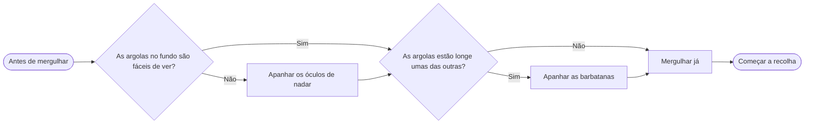

 pedro-section
# *O Noddy Vai À Piscina*
## Introdução
 Chegou o verão e o Noddy tem andado a implorar aos pais para ir à piscina municpal, porque nessa piscina costuma haver uma banca de gelados. Mas os pais só deixam o Noddy comer o gelado depois de Noddy concluir um desafio que os pais o propõem, já que os pais querem que Noddy aprenda a nadar. O Noddy pode encontrar itens na piscina que o vão beneficiar durante o desafio. O objetivo de Noddy é conseguir coletar todas as argolas que estão espalhadas pela piscina inteira e assim será recompensado com um gelado. Se Noddy não conseguir coletar todas as argolas, um Nadador Salvador salva o Noddy de se afogar e o jogo recomeça.

## Section 2 - Antonio
santiago-section
## Section 3 - Tiago
## Section 4 - Santiago
## Estratégia / Walktrough: *Noody vai à piscina*

### Fluxo geral do jogo

### Que itens apanhar primeiro?

**Recomendação:** apanha **sempre os dois itens** antes de mergulhar. Como estão fora de água, não custam tempo de ar, e tornam a parte díficil do jogo muito mais fácil.

## Estratégia debaixo de água

=======
## Section 3 - Santiago
## Section 4 - Tiago

 
=======
# Personagens ou itens

## Personagens
- Noddy
- Nadador Salvador
- Mae 

### Itens 

| Item | Efeito | Quando é mais útil |
|------|--------|--------------------|
|Óculos de nadar | Aumentam a visão debaixo de água | Quando as argolas são difíceis de ver ou estão espalhados |
| Barbatanas | Aumentam a velocidade a nadar | Quando os objetos estão longe uns dos outros |
| Argola | Objetivo do jogo | Quando o noddy apanha todas as argolas o hoje termina |
| Gelado | Recompensa | É Obtido quando todas as argolas sao apanhadas sendo esta a recompensa de conclusão |

 main
 main
