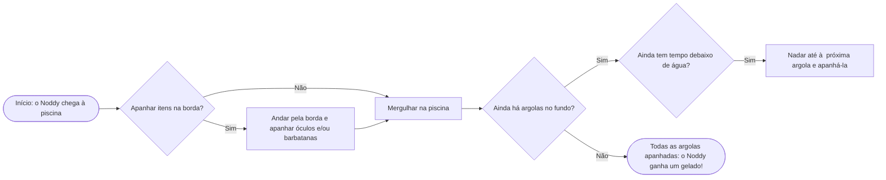
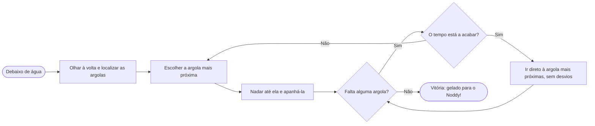

# Project
## Section 1 - Pedro
## Section 2 - Antonio
## Section 3 - Tiago
## Section 4 - Santiago
## Estratégia / Walktrough: *Noody vai à piscina*

### Fluxo geral do jogo

### Que itens apanhar primeiro?

**Recomendação:** apanha **sempre os dois itens** antes de mergulhar. Como estão fora de água, não custam tempo de ar, e tornam a parte díficil do jogo muito mais fácil.

## Estratégia debaixo de água

